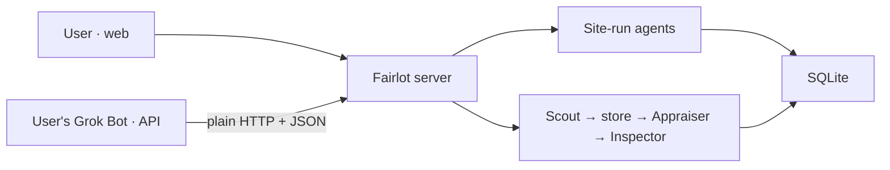

# Fairlot

Craigslist made effortless for SF Bay Area bikes, computers, and furniture. You say what you want; agents find the listings, vet every one, and haggle inside a max only the server knows. Built for the Berkeley × Stanford Grok Bot Hackathon, Best Design track.

- [Architecture](docs/ARCHITECTURE.md) — system, data model, API
- [Roadmap](docs/ROADMAP.md) — cut order and judging checklist
- [Tasks](docs/TASKS.md) — @unclesdad, @srivatsav-kannan, @heruirayli
- [Grok Bot integration](docs/GROKBOT_INTEGRATION.md) — bot-facing API and skill recipe
- [Integration](docs/INTEGRATION.md) — exact function signatures and call order
- Briefs: [A](docs/briefs/person-a-frontend.md) · [B](docs/briefs/person-b-agents.md) · [C](docs/briefs/person-c-data-api-ship.md)

## Inspiration

Classic classifieds make you refresh, squint at photos, and message strangers one by one. Scams and fantasy prices hide in the same feed as real deals. Fairlot flips that: you type the want ("road bike under $400 in SF"), and agents do the hunting, the scam check, the pricing, and the back-and-forth.

## What it does

- **Say the want.** On the site, or by telling your own Grok Bot. A buyer agent then searches seller listings and negotiates with each seller inside your private max. You can also point that agent at one listing.
- **Every listing arrives priced and scam-checked.** Scout, Appraiser, and Inspector run once for everyone, not per user. Cards show a deal verdict and a trust badge before anyone opens a chat.
- **Sellers start from a photo.** Lister drafts the post. A seller agent negotiates inside that seller's private minimum.
- **Limits stay private.** Your max and their minimum never leave the server, never reach the other side, and never reach your Grok Bot. The bot is the remote control; our server does the negotiating.

## How we built it

One public service: FastAPI serves the React app and `/api`. Site-run agents (Scout, Appraiser, Inspector, Lister, Buyer, Seller) call the Grok API from the server. A user's own Grok Bot is only a client of a small HTTP JSON API. Details and the diagram: [docs/ARCHITECTURE.md](docs/ARCHITECTURE.md).

**Scout.** `POST /api/scout/run` reads Craigslist SF Bay public search result pages for bikes, computers, and furniture (one page per category, at most 3 network fetches per run, a 2 s pause between them, 20 s timeout, a plain `FairlotScout` User-Agent, no cookies, sign-in, posting, or messaging). It keeps title, price, neighborhood, one photo URL, category, and the source link, skips posts without a price, and strips anything that looks like a phone number or email from titles. Pages are cached on disk for an hour (`backend/data/scout_cache/`, gitignored), and listings already stored are skipped. A 401/403/429/503 or a CAPTCHA stops the run with `stopped: true` and a reason; it never retries or works around a challenge. Each new row is appraised and inspected before it is written, in the same transaction, so the feed never shows a listing without its badges. Seed listings stay in place.



## Challenges we ran into

TODO

## Accomplishments

TODO

## What we learned

TODO

## What's next

TODO

## How Grok Bot helped build it

TODO

## How to run it

Dev API (stubs, no key required):

```bash
python3 -m venv .venv && . .venv/bin/activate
pip install -r backend/requirements.txt && uvicorn backend.app.main:app --port 8000
```

`GROK_API_KEY` stays empty until a real model call. Optional: `GROK_API_BASE_URL`, `CORS_ORIGINS`, `DATABASE_PATH`, `SCOUT_LIVE`. Copy `.env.example`. Frontend uses `VITE_API_BASE_URL` (empty means same origin). @unclesdad owns `frontend/`.

```bash
python -m pytest backend/tests -q
```

Leave `SCOUT_LIVE` unset when running tests so they stay offline (the tests call `POST /api/scout/run`).

Live Scout is off by default, so `POST /api/scout/run` adds nothing until you set `SCOUT_LIVE=1` in the server's environment:

```bash
SCOUT_LIVE=1 uvicorn backend.app.main:app --port 8000
curl -X POST localhost:8000/api/scout/run -H 'Content-Type: application/json' -d '{"categories":["bikes","computers","furniture"]}'
```

On Windows PowerShell: `backend\.venv\Scripts\activate`, then `$env:SCOUT_LIVE="1"` before `uvicorn`.

One service. FastAPI serves `frontend/dist` when that folder exists and still boots when it does not.

```bash
docker build -t fairlot . && docker run --rm -p 8000:8000 fairlot
```

Mount a built UI with `-v "$PWD/frontend/dist:/app/frontend/dist:ro"`.
