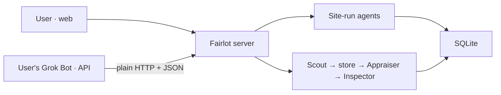

# Fairlot

Craigslist made effortless for SF Bay Area bikes, computers, and furniture. You say what you want; agents find the listings, vet every one, and haggle inside a max only the server knows. Built for the Berkeley × Stanford Grok Bot Hackathon, Best Design track.

- [Architecture](docs/ARCHITECTURE.md) — system, data model, API
- [Roadmap](docs/ROADMAP.md) — cut order and judging checklist
- [Tasks](docs/TASKS.md) — @unclesdad, @srivatsav-kannan, @heruirayli
- [Grok Bot integration](docs/GROKBOT_INTEGRATION.md) — bot-facing API and skill recipe

## Inspiration

Classic classifieds make you refresh, squint at photos, and message strangers one by one. Scams and fantasy prices hide in the same feed as real deals. Fairlot flips that: you type the want ("road bike under $400 in SF"), and agents do the hunting, the scam check, the pricing, and the back-and-forth.

## What it does

- **Say the want.** On the site, or by telling your own Grok Bot. A buyer agent then searches seller listings and negotiates with each seller inside your private max. You can also point that agent at one listing.
- **Every listing arrives priced and scam-checked.** Scout, Appraiser, and Inspector run once for everyone, not per user. Cards show a deal verdict and a trust badge before anyone opens a chat.
- **Sellers start from a photo.** Lister drafts the post. A seller agent negotiates inside that seller's private minimum.
- **Limits stay private.** Your max and their minimum never leave the server, never reach the other side, and never reach your Grok Bot. The bot is the remote control; our server does the negotiating.

## How we built it

One public service: FastAPI serves the React app and `/api`. Site-run agents (Scout, Appraiser, Inspector, Lister, Buyer, Seller) call the Grok API from the server. A user's own Grok Bot is only a client of a small HTTP JSON API. Details and the diagram: [docs/ARCHITECTURE.md](docs/ARCHITECTURE.md).

## Challenges we ran into

TODO

## Accomplishments

TODO

## What we learned

TODO

## What's next

TODO

## How Grok Bot helped build it

TODO

## How to run it

TODO: local run, env vars (`GROK_API_KEY` only on the server), and the single-service deploy (FastAPI serves the built frontend). No secrets in this file.
