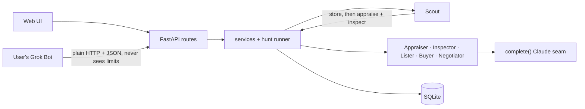

# Fairlot

Craigslist made effortless for SF Bay Area bikes, computers, and furniture. You say what you want; agents find the listings, vet every one, and haggle inside a max only the server knows. Built for the Berkeley × Stanford Grok Bot Hackathon, Best Design track.

Team: [@unclesdad](https://github.com/unclesdad) (frontend), [@srivatsav-kannan](https://github.com/srivatsav-kannan) (agents), [@heruirayli](https://github.com/heruirayli) (data, API, ship).

- [Architecture](docs/ARCHITECTURE.md) — system, data model, API
- [Roadmap](docs/ROADMAP.md) — cut order and judging checklist
- [Tasks](docs/TASKS.md) — @unclesdad, @srivatsav-kannan, @heruirayli
- [Grok Bot integration](docs/GROKBOT_INTEGRATION.md) — bot-facing API and skill recipe
- [Integration](docs/INTEGRATION.md) — exact function signatures and call order
- Briefs: [A](docs/briefs/person-a-frontend.md) · [B](docs/briefs/person-b-agents.md) · [C](docs/briefs/person-c-data-api-ship.md)

## Inspiration

Classic classifieds make you refresh, squint at photos, and message strangers one by one. Scams and fantasy prices hide in the same feed as real deals. Fairlot flips that: you type the want ("road bike under $400 in SF"), and agents do the hunting, the scam check, the pricing, and the back-and-forth.

## What it does

- **Browse a pre-vetted feed.** Every listing shows a price verdict (Good deal / Fair / Overpriced) and a trust badge (High / Medium / Low) before anyone opens a chat. Scout, Appraiser, and Inspector run once for everyone, not per user.
- **Sell from a photo.** Lister drafts the title, description, category, and suggested price. After publish, the new listing is already appraised and inspected. A seller agent negotiates inside that seller's private minimum.
- **Say the want, then hunt or target.** Type it on the Board, or tell your own Grok Bot. `POST /api/wants` stores a private max parsed from the text. Hunt matches listings and opens negotiations; target points the buyer agent at one listing. Buyer and seller agents haggle inside server-only limits.
- **Multi-round haggling.** The buyer agent opens low and concedes in shrinking steps over up to 6 rounds; the seller counters down from the asking price. Code clamps every offer to the buyer's private max and the seller's private min (`minimum` on publish, `max_price` or a budget in the want text), so a deal always lands between them and neither number is ever shown.
- **Grok Bot is a client, not the negotiator.** It calls the wants API (create, read, hunt, target) with a bearer token. Limits never leave the server, never reach the other side, and never reach the bot.
- **Live Scout.** With `SCOUT_LIVE=1`, Scout reads public Craigslist SF Bay search pages for bikes, computers, and furniture and adds them to the feed.

Twelve seed listings (`origin: "seed"`) ship with the API so the feed works before a live fetch.

## How we built it

One public service. **FastAPI** + **Uvicorn** serve `/api` (and `frontend/dist` when that folder exists) with **SQLite** for listings, wants, matches, negotiations, private limits, and tokens. **httpx** fetches Scout pages. Tests use **pytest**. The production image is a single **Docker** service (`python:3.12-slim`). The UI is **Vite + React + TypeScript**, owned by @unclesdad and merged in [PR #6](https://github.com/srivatsav-kannan/grokbot-hackathon/pull/6). Pages: Board (`/`), Listing (`/listings/:id`), Sell (`/sell`), Want (`/wants/:id`), and Negotiation (`/negotiations/:id`). [PR #8](https://github.com/srivatsav-kannan/grokbot-hackathon/pull/8) tightened the layouts and switched the board to a white and gold palette. FastAPI serves `frontend/dist` when that folder exists, and the API still boots without it.

Site-run agents call a single seam, `complete()`, with `ANTHROPIC_API_KEY` (optional `ANTHROPIC_MODEL`) from the environment only. A user's own Grok Bot talks to the same HTTP JSON API. Call graph: [docs/INTEGRATION.md](docs/INTEGRATION.md).

**What's live vs stub today**

- **Scout is live.** It reads Craigslist SF Bay public search result pages (one page per category, at most 3 network fetches per run, a 2 s pause between them, 20 s timeout, a plain `FairlotScout` User-Agent, no cookies, sign-in, posting, or messaging). It keeps title, price, neighborhood, one photo URL, category, and the source link, skips posts without a price, and strips anything that looks like a phone number or email from titles. Pages are cached on disk for an hour (`backend/data/scout_cache/`, gitignored). A 401/403/429/503 or a CAPTCHA stops the run with `stopped: true` and a reason; it never retries or works around a challenge. Each new row is appraised and inspected before it is written, in the same transaction. Live fetching only runs when `SCOUT_LIVE=1`. Scout does not call the LLM.
- **Appraiser, Inspector, Lister, Buyer (`parse_want` / `match_listings`), and Negotiator call Claude when `ANTHROPIC_API_KEY` is set.** A missing key, timeout, or error returns `None` from `complete()`, and each agent falls back to its `stub_*` result. Tests run with the key unset. Heuristics still produce verdicts, trust badges, drafts, matches, and transcripts.



## Challenges we ran into

- **Limits had to stay invisible.** Buyer ceilings and seller floors are used in negotiation but must never appear in responses, OpenAPI schemas, logs, or a Grok Bot chat. That forced a split: the service layer is the only place that reads them; agent return values and the wants API omit them. A leak test guards the contract.
- **A live fetcher had to stay polite.** Scout is capped at three public search pages, caches for an hour, and stops on a CAPTCHA or block instead of retrying. `SCOUT_LIVE` stays off by default so tests never hit the network.
- **Three tracks in one repo.** Ownership is path-based, and work lands on `a/`, `b/`, and `c/` feature branches as small PRs into `main`, so parallel Grok Bots do not overwrite each other.
- **The API had to work before the UI landed.** FastAPI serves `frontend/dist` when a build is present and still boots when it is not, so the feed stayed reachable while the frontend was in flight.

## Accomplishments

- Frozen API contract with the listings, lister, negotiations, Scout, and bearer-token wants routes, plus `GET /api/health`.
- SQLite schema and 12 seed listings across bikes, computers, and furniture, each with a verdict and a trust badge.
- Private limits stay on the server; `access_token` is returned once from `POST /api/wants`.
- Live Scout fetcher, merged in [PR #2](https://github.com/srivatsav-kannan/grokbot-hackathon/pull/2), with cache, contact scrubbing, and a hard stop on challenges.
- A one-service Docker image that boots with or without a frontend build.
- Photo-first Vite + React + TypeScript UI, merged in [PR #6](https://github.com/srivatsav-kannan/grokbot-hackathon/pull/6), with Board, Listing, Sell, Want, and Negotiation pages. [PR #8](https://github.com/srivatsav-kannan/grokbot-hackathon/pull/8) polished the board (white and gold, tighter layouts).

## What we learned

- Privacy holds up when it is an API and storage rule, not a UI promise: if the field is never selected, it cannot leak to a bot or a browser.
- A frozen contract and owned file paths let three Grok Bots ship in parallel without waiting on a shared checkout.
- A live scrape needs a feature flag and a defined failure: stop, report, and keep the seed feed.

## What's next

- The Render service needs `ANTHROPIC_API_KEY` in the dashboard for live model calls, and `SCOUT_LIVE=1` for live fetching. Stubs run when the key is missing.
- Make the repo public and submit. A cleaned Grok Bot session history is in the section below.

## How Grok Bot helped build it

Each teammate used their own Grok Bot on a separate track, in parallel, on feature branches with small PRs into `main`.

- @srivatsav-kannan's bot landed the server plumbing — routes, SQLite, seed data, agent stubs, Dockerfile, and tests — as [PR #1](https://github.com/srivatsav-kannan/grokbot-hackathon/pull/1), the Render deploy blueprint as [PR #4](https://github.com/srivatsav-kannan/grokbot-hackathon/pull/4), and live Claude calls in `complete()` with stub fallbacks as [PR #5](https://github.com/srivatsav-kannan/grokbot-hackathon/pull/5).
- @heruirayli's Grok Bot built the live Scout fetcher as [PR #2](https://github.com/srivatsav-kannan/grokbot-hackathon/pull/2) and wrote this README.
- @unclesdad's bot landed the Vite + React + TypeScript UI as [PR #6](https://github.com/srivatsav-kannan/grokbot-hackathon/pull/6) and polished the board in [PR #8](https://github.com/srivatsav-kannan/grokbot-hackathon/pull/8).

The cleaned session for that frontend build is in [docs/grok-bot-history.md](docs/grok-bot-history.md).

## How to run it

Dev API (stubs, no key required):

```bash
python3 -m venv .venv && . .venv/bin/activate
pip install -r backend/requirements.txt && uvicorn backend.app.main:app --port 8000
```

`ANTHROPIC_API_KEY` stays empty until a real model call. It is server-only and must not go in the frontend bundle. Optional: `ANTHROPIC_MODEL` (default `claude-haiku-4-5` for appraisals, parsing, and listing drafts), `ANTHROPIC_INSPECTOR_MODEL` (default `claude-sonnet-5-5` for scam checks), `ANTHROPIC_MESSAGE_MODEL` (default `claude-opus-5-5`) and `ANTHROPIC_MESSAGE_EFFORT` (default `low`) for negotiation lines, plus `CORS_ORIGINS`, `DATABASE_PATH`, `SCOUT_LIVE`, `SCOUT_INTERVAL_S`, and `BACKGROUND_INTERVAL_S`. Copy `.env.example`. Frontend uses `VITE_API_BASE_URL` (empty means same origin).

Frontend dev server (API already running on port 8000):

```bash
cd frontend
npm ci
npm run dev
```

Open http://localhost:5173. Vite proxies `/api` and `/placeholders` to http://127.0.0.1:8000. Leave `VITE_API_BASE_URL` empty for local dev and for a same-origin production build.

To serve the built UI from the same origin as the API:

```bash
cd frontend && npm ci && npm run build
uvicorn backend.app.main:app --port 8000
```

With `frontend/dist` present, `GET /` returns the app HTML, and deep links (`/listings/:id`, `/sell`, `/wants/:id`, `/negotiations/:id`, `/bots`, `/login`, `/signup`) fall back to `index.html`. `/api/listings` still returns JSON.

```bash
python -m pytest backend/tests -q
```

Leave `SCOUT_LIVE` unset when running tests so they stay offline (the tests call `POST /api/scout/run`).

Live Scout is off by default, so `POST /api/scout/run` adds nothing until you set `SCOUT_LIVE=1` in the server's environment:

```bash
SCOUT_LIVE=1 uvicorn backend.app.main:app --port 8000
curl -X POST localhost:8000/api/scout/run -H 'Content-Type: application/json' -d '{"categories":["bikes","computers","furniture"]}'
```

On Windows PowerShell: `backend\.venv\Scripts\activate`, then `$env:SCOUT_LIVE="1"` before `uvicorn`.

One service. The Docker image builds `frontend/` with Vite and FastAPI serves that SPA. Pass secrets and feature flags with `-e`, for example `-e SCOUT_LIVE=1`.

```bash
docker build -t fairlot . && docker run --rm -p 8000:8000 fairlot
```

## Deploy

Fairlot runs as one Render web service from the root Blueprint, [`render.yaml`](render.yaml). That service is [https://fairlot.onrender.com](https://fairlot.onrender.com): Docker runtime, free plan, region Oregon, health check `GET /api/health`, and automatic deploys on commits to `main`. The image listens on `0.0.0.0:$PORT` and builds `frontend/` with Vite. FastAPI serves the SPA at `/` (client routes fall back to `index.html`) and the API at `/api`.

Set `ANTHROPIC_API_KEY`, `ANTHROPIC_MODEL`, `ANTHROPIC_INSPECTOR_MODEL`, `ANTHROPIC_MESSAGE_MODEL`, and `ANTHROPIC_MESSAGE_EFFORT` in the Render dashboard. Each is `sync: false`, so the dashboard holds the values. `SCOUT_LIVE` is `1` in the Blueprint.

The free plan has no persistent disk. SQLite lives at `/tmp/fairlot.db`. On startup, an empty listings table is seeded again.

Free web services spin down after about 15 minutes without traffic. [`.github/workflows/keepalive.yml`](.github/workflows/keepalive.yml) sends a keep-alive ping to `https://fairlot.onrender.com/api/health` every ~10 minutes, and the same ping can be run from the Actions tab.

As of 3:57 PM PT on November 19, 2026, [https://fairlot.onrender.com](https://fairlot.onrender.com) served the built UI at `/` (the [PR #8](https://github.com/srivatsav-kannan/grokbot-hackathon/pull/8) assets), deep links such as `/listings/lst_02` and `/sell` fell back to `index.html`, `GET /api/health` returned `{"ok": true}`, and `GET /api/listings` still had only the 12 seed listings.

## Grok Bot session history

**Grok Bot session export: Herui Ray Li, Fairlot (Berkeley x Stanford Grok Bot Hackathon), Nov 19 2026**

This is a cleaned chronological log of user-visible messages from Herui's Grok Bot session while building Fairlot on November 19, 2026 (America/Los_Angeles). Internal tool calls, hidden prompts, and internal identifiers are omitted.

Cleaning follows the repo submission rule in `docs/ROADMAP.md`: "Grok Bot session export with personal info removed (names, emails, phone numbers, tokens)." Emails, phone numbers, tokens, API keys, passwords, access tokens, and machine identifiers were removed or were never present in the visible chat. Local checkout paths are shortened to the repo name. Buyer and seller price limits (`buyer_max` / `seller_min`) are omitted. GitHub handles already public in this repository (`@heruirayli`, `@srivatsav-kannan`, `@unclesdad`) are kept so the build story stays readable. The session owner's first name is kept because it is how the bot was asked to address him and already appears as `@heruirayli`.

Times below are in America/Los_Angeles (PT) when they were recorded in the session.

---

## Onboarding and repo setup

**Herui:** Kept the bot's name as "Grok Bot" during onboarding. Connected Gmail, Calendar, and Drive.

**Herui:** connect to my github so that you can automatically push to repos

**Grok Bot:** Connected GitHub as `@heruirayli`.

**Herui:** connect to https://github.com/srivatsav-kannan/grokbot-hackathon

**Grok Bot:** Connected to the private repo. Default branch is `main`, and Herui has push access.

**Herui:** clone the repo inside [local Projects folder] and wait until i want you to pull everything since itll have all the instructions for what to do later

**Grok Bot:** Cloned `grokbot-hackathon` into the local Projects folder and waited for further instructions. Later work stayed in that local checkout, on feature branches named `c/<feature>`, with small PRs into `main`.

**Herui:** tell cursor from now on don't include any coauthor messages in github

**Grok Bot:** Agreed to a standing rule: never include Co-authored-by or any AI or co-author attribution in commits or PRs.

**Herui:** pull from the repo. i am person c. make sure to update the repo's readme with stuff as it works. don't begin yet, wait for further instructions inside the repo telling what to do for the api.

**Grok Bot:** Pulled `main`, identified Herui's ownership (Data, API, and ship: backend routes, Scout, README, deploy help, submission), and waited before building the API.

**Herui:** the agents will work in parallel on the teammates computers so make sure that the way you code only works on your part and merge it in later as a feature branch

**Grok Bot:** Agreed to touch only Herui's files, work on `c/<feature>` branches, and land changes as small PRs.

**Herui:** don't refer to person c from now on, i am person c

**Grok Bot:** Agreed to stop using "Person C" and to refer to that work as Herui's part.

---

## Waiting on the API, then building Scout

**Herui:** is it ready to build now? pull

**Grok Bot:** Pulled again and reported status.

**Herui:** pull again

**Grok Bot:** Pulled `main`.

**Herui:** pull from github

**Grok Bot:** Pulled `main` again.

**Herui:** wait sri's bot is already building out the API. jsut wait for now

**Grok Bot:** Stopped an in-progress backend build so @srivatsav-kannan's bot could finish the API plumbing. Nothing from that interrupted attempt was landed.

**Herui:** yes please

**Grok Bot:** Watched for Sri's API work and waited.

**Herui:** pull it now.

**Grok Bot:** Pulled the updated API work from `main`.

**Herui:** go ahead

**Grok Bot:** Started Scout work on `c/scout`, including tests at first.

**Herui:** grokbot can run commands on my computer i give permission

**Grok Bot:** Noted local-command permission and pointed Herui at the setting needed to allow local execution.

**Herui:** yes

**Grok Bot:** Proceeded with local execution in the `grokbot-hackathon` checkout.

**Herui:** skip running tests and just build it out

**Grok Bot:** Stopped adding or running tests and finished the Scout fetcher. PR #2 covered the Scout fetcher, deduping, cache-directory ignore rules, a `SCOUT_LIVE` env flag, and README notes. Tests were not run for that PR, as requested.

**Herui:** yes go ahead and merge it in

**Grok Bot:** Squash-merged [PR #2](https://github.com/srivatsav-kannan/grokbot-hackathon/pull/2) (Scout fetcher) into `main`, with no co-author attribution.

---

## README, deploy, and live site

**Herui:** we're planning to do it on render.

**Grok Bot:** Noted Render as the deploy target.

**Herui:** i'm not the one deploying, sri is

**Grok Bot:** Left Render dashboard work to @srivatsav-kannan and stayed on README, API checks, and Herui's files.

**Herui:** yes go ahead and start

**Grok Bot:** Filled in the README on a `c/` branch as things started working.

**Herui:** merge it

**Grok Bot:** Merged the README PR ([PR #3](https://github.com/srivatsav-kannan/grokbot-hackathon/pull/3)) into `main`, with no co-author attribution.

**Herui:** is person c's part done

**Grok Bot:** Summarized what was done on Herui's track (Scout, README, privacy rules, API serving) and what was still waiting on teammates or a later submission step (confirm the live URL, make the repo public, add a cleaned session export, submit).

**Herui:** yes

**Grok Bot:** Watched teammate merges and ran follow-up checks so the README and API docs stayed accurate.

**Herui:** where is the website deployed so i can try a demo

**Grok Bot:** The demo is live at https://fairlot.onrender.com.

Teammate PRs that landed around this time, and that Grok Bot pulled and checked against the API, included:

- [PR #4](https://github.com/srivatsav-kannan/grokbot-hackathon/pull/4) — Render deploy setup (@srivatsav-kannan)
- [PR #5](https://github.com/srivatsav-kannan/grokbot-hackathon/pull/5) — model-backed agents with stub fallbacks (@srivatsav-kannan)
- [PR #6](https://github.com/srivatsav-kannan/grokbot-hackathon/pull/6) and [PR #7](https://github.com/srivatsav-kannan/grokbot-hackathon/pull/7) — frontend and README / integration notes
- [PR #8](https://github.com/srivatsav-kannan/grokbot-hackathon/pull/8) — frontend polish, white and gold, tighter layouts (@unclesdad)

Grok Bot confirmed the live site served the built frontend, page links and the health check worked, and frontend API field expectations still matched the backend. README updates for the live site landed as [PR #9](https://github.com/srivatsav-kannan/grokbot-hackathon/pull/9).

Notes from that check (no secrets included): the public feed still showed the 12 seed listings because live Craigslist fetching is off unless `SCOUT_LIVE=1` is set on the host, and agents use a server-side model key with a canned fallback when that key is missing. Those host settings were left for Sri.

---

## Multi-round negotiation

**Herui:** make the negotiation have a maximum price to buy for and a minimum price to sell for. the bots should try to drive the price as low as possible by negotiating through multiple rounds. add this in a branch and merge it in later

**Grok Bot:** Started the work on `c/negotiation-limits`. Because negotiator code is owned by @srivatsav-kannan, the PR would tag him. The branch would stay open until Herui asked to merge. Each bot would concede a little more every round but never go past its own private limit. Neither side would see the other's limit, and the API, logs, and chat messages would not show it.

**Herui:** eta?

**Grok Bot:** Said the PR should be open in about 10 to 15 minutes, with the link sent as soon as it was up.

**Herui:** go faster the deadline is 4:35pm

**Grok Bot:** Cut the change down to the essentials, aiming to open the PR around 4:25 PM PT so there would still be time to merge.

**Herui:** merge it automatically

**Grok Bot:** Agreed to merge into `main` as soon as the PR opened and the code compiled, and to send the link afterward.

**Grok Bot:** Multi-round negotiation merged into `main` as [PR #10](https://github.com/srivatsav-kannan/grokbot-hackathon/pull/10) at 4:17 PM PT. The local checkout was updated, the code compiled, and tests were skipped as requested. No co-author attribution was added.

The bots now negotiate for up to 6 rounds. The buyer opens low and raises by less each round; the seller lowers its counter from the asking price; on a close counter the buyer offers halfway instead of accepting immediately. The final price always lands between the two private limits. Neither limit is shown to the other side or in any message. If the limits do not overlap, it ends with no deal. In a local test on a $900 listing, the deal closed at $595 in round 5. Sri had also just pushed an update, so the PR combined that work and kept his seller-floor field. The PR mentioned him because `negotiator.py` and its test were touched.

**Herui:** ]

**Grok Bot:** Treated that as a stray key and asked whether to check the live site once Render redeployed.

**Herui:** yes

**Grok Bot:** Watched the live site until the new deploy was up, then ran a negotiation there.

**Grok Bot:** Multi-round negotiation was working on https://fairlot.onrender.com after a deploy at 4:19 PM PT. A live test on the $360 road bike went: buyer opened at $215, the bots went back and forth for 4 rounds, and they settled at $320. Neither side's limit appeared anywhere. After a deal closed, the want still showed as "negotiating," which was called out as cosmetic and left alone before the 4:35 PM PT deadline. Posting a want on the live site now requires sign-in.

**Herui:** why for the craigslist postings you cant do negotiate

**Grok Bot:** Explained that this is intentional. A Craigslist seller is a real person who is not on Fairlot, so there is no seller bot and no seller minimum on Fairlot. Those listings are saved as matches with a link to the real post. The listing page hides the offer form for them, and the server skips them when opening a negotiation. A pretend seller could be added, but the deal would be fake and the real seller would not know. With little time left before the deadline, Grok Bot recommended leaving it and saying in the demo that Fairlot bots negotiate with Fairlot sellers and only scout outside listings.

---

## Pitch deck handoff

**Herui:** summarize everything so that the pitch deck bot has the info to build out the pitch

**Grok Bot:** Sent a Fairlot summary to the Pitch Deck Bot and asked it to build the pitch before 4:35 PM PT. The summary covered the problem, each bot in the pipeline, private multi-round negotiation (including the live $360-to-$320 bike deal), trust and safety, the white-and-gold design for the Best Design track, the tech stack, who built what, a suggested demo flow, and links to the live site and the repo.

**Grok Bot:** Shared the 7-slide deck the Pitch Deck Bot had already finished, with a QR code pointing at the live site, and noted that a v3 with the multi-round negotiation and the $320 bike deal was in progress. If v3 was not ready before 4:35 PM PT, v2 could be used.

**Grok Bot:** Later passed along v3 of the deck, which adds the multi-round negotiation and the $320 bike deal on slide 4, and PR #10 on slide 6.

---

## Session export

**Herui:** upload the grok bot history to github

**Grok Bot:** Added this cleaned session export on branch `c/session-export` and merged it into `main`.

---

## Project facts recorded in this session (for reviewers)

- Product: Fairlot, built for the Berkeley x Stanford Grok Bot Hackathon, Best Design track.
- Live demo: https://fairlot.onrender.com
- Repo: https://github.com/srivatsav-kannan/grokbot-hackathon
- Stack: FastAPI, Uvicorn, SQLite, Vite, React, TypeScript, Docker, one service on Render. FastAPI serves the frontend build with SPA fallback.
- Privacy rule, unchanged: buyer and seller limits and token hashes never appear in responses, logs, or the frontend. An access token is returned once from want creation and is used as Bearer auth; it is not included in this export.
- Herui's track: data, API, Scout, ship, README, and submission. Teammate bots worked in parallel on their own machines. Changes landed through `c/<feature>` branches and small PRs, with no co-author or AI attribution on commits or PRs.

---

## Grok Bot session export — Person B (agents)

Full Grok Bot session from the teammate who owned AI agents. Personal info (names, emails, phone numbers, API keys, tokens) removed. Nov 19, 2026, America/Los_Angeles.

<details>
<summary>Full session (personal info removed)</summary>

### Kickoff

**Owner:** We're at the Berkeley × Stanford Grok Bot Hackathon, Best Design track. Rebuild Craigslist for the SF Bay Area (bikes, computers, furniture) so Grok Bots do the work: Scout, Appraiser, Inspector, Lister, Buyer and Seller agents. Rules: read public pages only; never sign in, post, message, buy, or create accounts; keep volume low; stop on CAPTCHA/blocks; never put names, emails, phones, keys, or tokens in replies. Repo: `https://github.com/[handle]/grokbot-hackathon`.

**Grok Bot:** Saved the project and rules. Connected to the empty private repo and prepared to scaffold.

**Owner:** Shared the tracks guide PDF for reference.

**Grok Bot:** Read the guide. Best Design needs a deployed public link (no login wall, laptop + phone), a public GitHub repo with README and Grok Bot session export (personal info removed), and the nine README sections.

### Plan first

**Owner:** Wait. First give me a whole roadmap and architecture and push it to GitHub. Split tasks between the three of us.

**Grok Bot:** Stopped the code scaffold. Pushed `docs/ARCHITECTURE.md`, `docs/ROADMAP.md`, `docs/TASKS.md`, and a README stub to `main` via a Cursor cloud agent. Split: Person A frontend, Person B agents, Person C data/API/ship.

**Owner:** Assigned roles (Person A = Team member A / frontend; Person B = [owner] / agents; Person C = Team member C / data, API, ship).

### Product direction

**Owner:** A user types what they want (native Grok Bot integration). Bots find sellers and negotiate. The user can also point a buyer bot at a listing. Scam checks run globally, not per user. Clarified how the bot runs inside the app.

**Grok Bot:** Updated docs: wants + hunting buyer agents; Scout/Appraiser/Inspector stay global; private max never leaves the server; a user's own Grok Bot is only a client of the public wants API. Cut order: feed + badges → wants + hunt → Grok Bot integration demo.

### Deploy as we go

**Owner:** Build all this and start deployment. Deploy as we go on Render. Keep it alive by pinging. Spawn parallel subagents.

**Grok Bot:** Launched parallel Cursor cloud agents for deploy plumbing (Dockerfile, `render.yaml`, `/api/health`, GitHub Actions keepalive every 10 minutes), Claude-backed agents (no Grok API credits), and the main product build. Live site: `https://fairlot.onrender.com`.

**Owner:** Switch to Claude as the agent; we don't have Grok API credits. Later: Opus 5.5 on low for negotiation messages; Sonnet 5.5 for scam Inspector; Haiku as default. Paste the key into Render as `ANTHROPIC_API_KEY`.

**Grok Bot:** Wired `complete()` to Anthropic with those model overrides and env vars. Documented how to set the key in Render (never commit it).

### AI-native marketplace

**Owner:** Buyer and seller both AI-native. Background loop finds new sellers; users can list. Scout aggregates other marketplaces with scam detection. Prefer native listings; for external ones tell the user what to do (suggested offer + copyable message). Add email/password auth. Push frontend to Render. No PRs — merge all outstanding ones.

**Grok Bot:** Merged open PRs into `main`. Added auth, background scout cycle, multi-marketplace scout (Craigslist live; others blocked by 403/login), and frontend wiring. Set `SCOUT_LIVE=1` on Render.

**Owner:** No sample labels. Search shows a few listings then an option to fire a persistent buyer bot. Clean place for buyer bots and seller bots, with notifications. Listings are AI-native. If search is empty, run Scout (demo). Use something not too expensive for models.

**Grok Bot:** Steered the build: buyer-bot card on search, Deals hub for bots, on-empty-search scout, private min/max next to the offer box, human vs bot-negotiates toggle, Opus for messages / Sonnet for Inspector / Haiku default.

### Hardening the core loop

**Owner:** The Huffy bike is not Craigslist — it was a demo. Verify real Craigslist is in. Everything must be fully usable, idempotent, and have one path per workflow. Wrap it up and make all the workflows come alive.

**Owner:** Sell-from-photo / login UX is bad. Logout is in the middle. No clarity. Sell is highlighted wrong. Accounts get blocked. Agent chat is bad. Want chatboxes. Send-buyer-agent and Make-an-offer are broken. No sale idempotency, no completion record, no storage.

**Grok Bot:** Found root cause: SQLite on `/tmp` wiped on every free-tier restart/deploy. Steered the build to: Postgres via `DATABASE_URL` with schema `fairlot` only (shared free DB, separate from another project); fix make-offer and send-buyer-bot with Idempotency-Key; one immutable sale/completion record that marks the listing sold; Deals as a messaging UI (conversation list + chat bubbles + composer); clean header (Log out in account menu).

**Owner:** Use the existing free trialviz Postgres with a separate fairlot schema. Then: time is almost up — just do core functionality and fix the UI.

**Grok Bot:** Asked [owner] to paste the Internal Database URL into Fairlot's `DATABASE_URL` on Render (password not readable via API). Cut scope to core loop + UI. After the push landed, live checks showed:
- `GET /api/health` → `{"ok": true, "database": "postgres"}`
- `/login`, `/signup`, `/deals` return 200 and the SPA
- Signup survives redeploy
- Offer with same Idempotency-Key returns the same thread
- Accept creates one sale (`sold_for`) and a second accept is a no-op
- Buyer bot from search appears in Deals immediately

**Owner:** Pause all agents.

**Grok Bot:** Cancelled the running cloud agent and background watchers. Confirmed the core fixes already on `https://fairlot.onrender.com`.

### Session export

**Owner:** Upload Grok Bot history to GitHub the way the tracks guide requires. Put it in the README.

**Grok Bot:** Guide requires the full session export with personal info removed in the public repo (and README with the nine sections). Appended this cleaned Person B export to `README.md` (Team member C's export already present). Repo still needs to be made public before final submission.

### How Grok Bot helped (Person B)

- Wrote and pushed architecture, roadmap, and task split at kickoff.
- Launched and steered Cursor cloud agents for scaffold, agents, Scout, Render deploy, and the core loop.
- Wired Claude models (Haiku / Opus messages / Sonnet Inspector) and private-limit leak rules.
- Diagnosed wiped accounts (`/tmp` SQLite) and moved Fairlot to Postgres schema `fairlot`.
- Drove the final core path: auth → browse → make offer → chat → accept → one completion record; plus buyer bots in Deals and a chat-first Deals UI.

</details>
