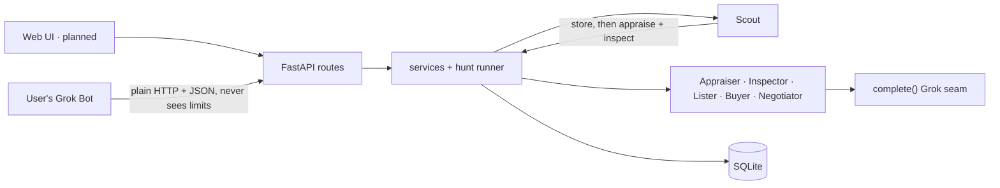

# Fairlot

Craigslist made effortless for SF Bay Area bikes, computers, and furniture. You say what you want; agents find the listings, vet every one, and haggle inside a max only the server knows. Built for the Berkeley × Stanford Grok Bot Hackathon, Best Design track.

Team: [@unclesdad](https://github.com/unclesdad) (frontend), [@srivatsav-kannan](https://github.com/srivatsav-kannan) (agents), [@heruirayli](https://github.com/heruirayli) (data, API, ship).

- [Architecture](docs/ARCHITECTURE.md) — system, data model, API
- [Roadmap](docs/ROADMAP.md) — cut order and judging checklist
- [Tasks](docs/TASKS.md) — @unclesdad, @srivatsav-kannan, @heruirayli
- [Grok Bot integration](docs/GROKBOT_INTEGRATION.md) — bot-facing API and skill recipe
- [Integration](docs/INTEGRATION.md) — exact function signatures and call order
- Briefs: [A](docs/briefs/person-a-frontend.md) · [B](docs/briefs/person-b-agents.md) · [C](docs/briefs/person-c-data-api-ship.md)

## Inspiration

Classic classifieds make you refresh, squint at photos, and message strangers one by one. Scams and fantasy prices hide in the same feed as real deals. Fairlot flips that: you type the want ("road bike under $400 in SF"), and agents do the hunting, the scam check, the pricing, and the back-and-forth.

## What it does

- **Browse a pre-vetted feed.** Every listing shows a price verdict (Good deal / Fair / Overpriced) and a trust badge (High / Medium / Low) before anyone opens a chat. Scout, Appraiser, and Inspector run once for everyone, not per user.
- **Sell from a photo.** Lister drafts the title, description, category, and suggested price. After publish, the new listing is already appraised and inspected. A seller agent negotiates inside that seller's private minimum.
- **Say the want, then hunt or target.** Type it on the site (when the UI lands) or tell your own Grok Bot. `POST /api/wants` stores a private max parsed from the text. Hunt matches listings and opens negotiations; target points the buyer agent at one listing. Buyer and seller agents haggle inside server-only limits.
- **Grok Bot is a client, not the negotiator.** It calls the wants API (create, read, hunt, target) with a bearer token. Limits never leave the server, never reach the other side, and never reach the bot.
- **Live Scout.** With `SCOUT_LIVE=1`, Scout reads public Craigslist SF Bay search pages for bikes, computers, and furniture and adds them to the feed.

Twelve seed listings (`origin: "seed"`) ship with the API so the feed works before a live fetch.

## How we built it

One public service. **FastAPI** + **Uvicorn** serve `/api` (and `frontend/dist` when that folder exists) with **SQLite** for listings, wants, matches, negotiations, private limits, and tokens. **httpx** fetches Scout pages. Tests use **pytest**. The production image is a single **Docker** service (`python:3.12-slim`). The planned UI is **Vite + React + TypeScript**, owned by @unclesdad; `frontend/` is not in the repo yet, and the API still boots without it.

Site-run agents call a single Grok seam, `complete()`, with `GROK_API_KEY` (optional `GROK_API_BASE_URL`) from the environment only. A user's own Grok Bot talks to the same HTTP JSON API. Call graph: [docs/INTEGRATION.md](docs/INTEGRATION.md).

**What's live vs stub today**

- **Scout is live.** It reads Craigslist SF Bay public search result pages (one page per category, at most 3 network fetches per run, a 2 s pause between them, 20 s timeout, a plain `FairlotScout` User-Agent, no cookies, sign-in, posting, or messaging). It keeps title, price, neighborhood, one photo URL, category, and the source link, skips posts without a price, and strips anything that looks like a phone number or email from titles. Pages are cached on disk for an hour (`backend/data/scout_cache/`, gitignored). A 401/403/429/503 or a CAPTCHA stops the run with `stopped: true` and a reason; it never retries or works around a challenge. Each new row is appraised and inspected before it is written, in the same transaction. Live fetching only runs when `SCOUT_LIVE=1`. Scout does not call the LLM.
- **Appraiser, Inspector, Lister, Buyer (`parse_want` / `match_listings`), and Negotiator are still stubs.** Each calls `complete()` then uses its `stub_*` fallback. `complete()` itself is not wired to the Grok HTTP API yet: even with a key set, it returns `None`, which is the documented "use the stub" signal. Heuristics still produce verdicts, trust badges, drafts, matches, and transcripts so the API is usable.



## Challenges we ran into

- **Limits had to stay invisible.** Buyer ceilings and seller floors are used in negotiation but must never appear in responses, OpenAPI schemas, logs, or a Grok Bot chat. That forced a split: the service layer is the only place that reads them; agent return values and the wants API omit them. A leak test guards the contract.
- **A live fetcher had to stay polite.** Scout is capped at three public search pages, caches for an hour, and stops on a CAPTCHA or block instead of retrying. `SCOUT_LIVE` stays off by default so tests never hit the network.
- **Three tracks in one repo.** Ownership is path-based, and work lands on `a/`, `b/`, and `c/` feature branches as small PRs into `main`, so parallel Grok Bots do not overwrite each other.
- **The UI is still in flight.** FastAPI is ready to serve `frontend/dist`, but that folder is not merged yet, so a visitor to `/` currently gets a short JSON note that the API is ready.

## Accomplishments

- Frozen API contract with all 11 routes: listings, lister, negotiations, Scout, and the bearer-token wants API (create, read, hunt, target).
- SQLite schema and 12 seed listings across bikes, computers, and furniture, each with a verdict and a trust badge.
- Private limits stay on the server; `access_token` is returned once from `POST /api/wants`.
- Live Scout fetcher, merged in [PR #2](https://github.com/srivatsav-kannan/grokbot-hackathon/pull/2), with cache, contact scrubbing, and a hard stop on challenges.
- A one-service Docker image that boots with or without a frontend build.

## What we learned

- Privacy holds up when it is an API and storage rule, not a UI promise: if the field is never selected, it cannot leak to a bot or a browser.
- A frozen contract and owned file paths let three Grok Bots ship in parallel without waiting on a shared checkout.
- A live scrape needs a feature flag and a defined failure: stop, report, and keep the seed feed.

## What's next

- Land @unclesdad's photo-first React UI and serve it from the same origin.
- Let @srivatsav-kannan wire `complete()` to live Grok calls; stubs already kick in if the key is missing or the call fails.
- Deploy one public HTTPS URL on Render, handled by @srivatsav-kannan. That service will need `SCOUT_LIVE=1` for live fetching, and `GROK_API_KEY` as a secret once `complete()` is live.
- Make the repo public, export a cleaned Grok Bot session, and submit.

## How Grok Bot helped build it

Each teammate used their own Grok Bot on a separate track, in parallel, on feature branches with small PRs into `main`.

- @srivatsav-kannan's bot landed the server plumbing — routes, SQLite, seed data, agent stubs, Dockerfile, and tests — as [PR #1](https://github.com/srivatsav-kannan/grokbot-hackathon/pull/1).
- @heruirayli's Grok Bot built the live Scout fetcher as [PR #2](https://github.com/srivatsav-kannan/grokbot-hackathon/pull/2) and wrote this README.
- @unclesdad's bot is building the frontend on the `a/…` track; that work is not merged yet.

## How to run it

Dev API (stubs, no key required):

```bash
python3 -m venv .venv && . .venv/bin/activate
pip install -r backend/requirements.txt && uvicorn backend.app.main:app --port 8000
```

`GROK_API_KEY` stays empty until a real model call. It is server-only and must not go in the frontend bundle. Optional: `GROK_API_BASE_URL`, `CORS_ORIGINS`, `DATABASE_PATH`, `SCOUT_LIVE`. Copy `.env.example`. Frontend uses `VITE_API_BASE_URL` (empty means same origin). @unclesdad owns `frontend/`.

```bash
python -m pytest backend/tests -q
```

Leave `SCOUT_LIVE` unset when running tests so they stay offline (the tests call `POST /api/scout/run`).

Live Scout is off by default, so `POST /api/scout/run` adds nothing until you set `SCOUT_LIVE=1` in the server's environment:

```bash
SCOUT_LIVE=1 uvicorn backend.app.main:app --port 8000
curl -X POST localhost:8000/api/scout/run -H 'Content-Type: application/json' -d '{"categories":["bikes","computers","furniture"]}'
```

On Windows PowerShell: `backend\.venv\Scripts\activate`, then `$env:SCOUT_LIVE="1"` before `uvicorn`.

One service. FastAPI serves `frontend/dist` when that folder exists and still boots when it does not.

```bash
docker build -t fairlot . && docker run --rm -p 8000:8000 fairlot
```

The image builds `frontend/` and FastAPI serves that SPA. Pass secrets and feature flags with `-e`, for example `-e SCOUT_LIVE=1`.

## Deploy

Fairlot runs as one Render web service from the root Blueprint, [`render.yaml`](render.yaml). That service is [https://fairlot.onrender.com](https://fairlot.onrender.com): Docker runtime, free plan, region Oregon, health check `GET /api/health`, and automatic deploys on commits to `main`. The image listens on `0.0.0.0:$PORT` and builds `frontend/` with Vite. FastAPI serves the SPA at `/` (client routes fall back to `index.html`) and the API at `/api`.

Set `ANTHROPIC_API_KEY` and `ANTHROPIC_MODEL` in the Render dashboard. Both are `sync: false`, so the dashboard holds the values.

The free plan has no persistent disk. SQLite lives at `/tmp/fairlot.db`. On startup, an empty listings table is seeded again.

Free web services spin down after about 15 minutes without traffic. [`.github/workflows/keepalive.yml`](.github/workflows/keepalive.yml) sends a keep-alive ping to `https://fairlot.onrender.com/api/health` every ~10 minutes, and the same ping can be run from the Actions tab.
