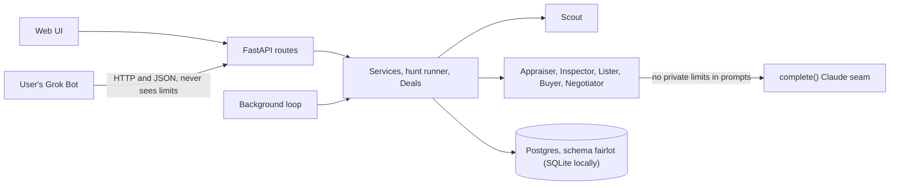

# Fairlot

Fairlot is Craigslist rebuilt around agents for SF Bay Area bikes, computers, and furniture. You say what you want, and site-run agents find listings, price them, check them for scams, and negotiate inside limits that only the server knows.

- **Live site:** https://fairlot.onrender.com
- **Demo login for judges:** `demo@fairlot.app` / `fairlot-demo` (or press "Log in as demo" on the home page). The demo account owns the lounge set listing, which has an offer waiting in Deals, so you can try both the buyer and the seller side.
- **Event and track:** Berkeley x Stanford Grok Bot Hackathon, November 19, 2026, Best Design track
- **Team:**

| Person | GitHub | Role |
| --- | --- | --- |
| Charlie Kerr | [@unclesdad](https://github.com/unclesdad) | Person A, frontend and design |
| Srivatsav Kannan | [@srivatsav-kannan](https://github.com/srivatsav-kannan) | Person B, AI agents |
| Ray Li | [@heruirayli](https://github.com/heruirayli) | Person C, data, API, and ship |

**Docs**

- [docs/grok-bot-sessions/](docs/grok-bot-sessions/README.md): the cleaned Grok Bot session export from each teammate
- [docs/architecture/ARCHITECTURE.md](docs/architecture/ARCHITECTURE.md): system, data model, and API contract from kickoff
- [docs/architecture/INTEGRATION.md](docs/architecture/INTEGRATION.md): function signatures and call order
- [docs/architecture/GROKBOT_INTEGRATION.md](docs/architecture/GROKBOT_INTEGRATION.md): the wants API a user's own Grok Bot calls
- [docs/planning/ROADMAP.md](docs/planning/ROADMAP.md): build phases, cut order, and the Best Design checklist
- [docs/planning/TASKS.md](docs/planning/TASKS.md): the task split between the three of us
- [docs/planning/briefs/](docs/planning/briefs/): one brief per teammate ([A](docs/planning/briefs/person-a-frontend.md), [B](docs/planning/briefs/person-b-agents.md), [C](docs/planning/briefs/person-c-data-api-ship.md))

## Inspiration

Buying a used bike, laptop, or desk on Craigslist means refreshing search pages, guessing whether a price is fair, judging scam risk from a few photos, and messaging sellers one at a time. We wanted a marketplace where a person says what they want and agents do that work. They find the listings, check each one for price and scam signals, and negotiate inside a limit the person sets, without that limit ever reaching the other side.

## What it does

- **A vetted feed.** The Board shows real Craigslist SF Bay listings read by the Scout agent next to 23 sample listings with stock photos. Every listing carries a price verdict from the Appraiser (Good deal, Fair, or Overpriced) and a trust level from the Inspector (High, Medium, or Low trust). Appraisal and inspection run once per listing for everyone, so every user sees the same checks.
- **Search that goes and looks.** When a search finds nothing, Scout runs a live Craigslist query for it, and new results are appraised and inspected before they appear. From the search results you can start a buyer bot that keeps working on that want.
- **Sell from a photo.** The Lister agent drafts a title, description, category, and suggested price from one photo. The seller edits the draft, can set a private minimum, and publishes. The listing is appraised and inspected as it is stored.
- **Deals.** There is one thread per listing and buyer. You can message the seller yourself or switch on your bot. The buyer's max and the seller's min are stored on the server. The negotiation strategy code uses them to pick every number, and the language model that writes the message text never sees them, so a counterpart cannot talk them out of it. When a bot reaches an agreement, the buyer approves it before anything is recorded. A sale writes one completion record and marks the listing sold. Writes take an `Idempotency-Key` header, so a repeated offer or accept returns the same result.
- **One place for every conversation.** The Deals page lists your buyer bots (status, matches, and conversations), your direct conversations, the incoming offers on your listings, and your completed deals. Notifications for offers, counteroffers, and deals appear in the header.
- **Outside listings.** Craigslist sellers are not on Fairlot, so there is no seller bot to negotiate with. For those listings a buyer bot gives a suggested offer and a message to send through the original post.
- **Your own Grok Bot as a client.** A user's Grok Bot can create a want and run a hunt through the HTTP wants API in [GROKBOT_INTEGRATION.md](docs/architecture/GROKBOT_INTEGRATION.md). Negotiation still runs on the Fairlot server, and the bot never receives a buyer's max or a seller's min.

## How we built it (tech stack)

| Layer | What we used |
| --- | --- |
| Backend | Python 3.12, FastAPI, Uvicorn, SQLAlchemy, httpx, pytest |
| Database | Postgres in production through `DATABASE_URL`, with every table in the `fairlot` schema. SQLite is the fallback for local development (`backend/app/db.py`). |
| Frontend | Vite, React 19, TypeScript, React Router, GSAP scroll effects, IBM Plex Sans and Newsreader fonts |
| Models | Claude through one seam, `complete()` in `backend/app/agents/llm.py` |
| Hosting | One Docker web service on Render (free plan) from [`render.yaml`](render.yaml), with a GitHub Actions keep-alive ping every 10 minutes ([`.github/workflows/keepalive.yml`](.github/workflows/keepalive.yml)) |

FastAPI serves the API at `/api` and the built frontend at `/`, with client routes falling back to `index.html`. The Dockerfile builds the frontend in a Node 22 stage and copies the build into the Python image.

**Agents.** Scout reads public search pages. Appraiser sets an estimated value range and the verdict. Inspector sets the trust level and plain-language signals. Lister drafts a listing from a photo. Buyer parses a want and matches listings. Negotiator runs the buyer and seller sides of a deal.

**Models.** We used Claude because the team had no Grok API credits. Claude Haiku (`claude-haiku-4-5`) is the default for appraisals, want parsing, and listing drafts. Sonnet 5.5 (`claude-sonnet-5-5`) runs the scam Inspector. Opus 5.5 (`claude-opus-5-5`) at low effort writes the negotiation messages. Each default can be changed with an environment variable. When the key is missing or a call fails, each agent falls back to a rule-based result, so the site keeps working.

**Listings.** Scout reads Craigslist SF Bay search pages for the three categories. It is read-only and low volume: at most 3 fetches per source per run, 2 seconds between requests, and a one-hour page cache. It runs on a background cycle (every 600 seconds by default) and when a search comes back empty. A 401, 403, 429, 503, or CAPTCHA stops that source for the run without a retry. The repo also has readers for eBay, OfferUp, and Mercari, and skip stubs for Facebook Marketplace and Nextdoor ([`backend/app/sources/`](backend/app/sources/)). eBay and Mercari returned 403 blocks, OfferUp ignored the requested location and fell back to a default US one, and Facebook Marketplace and Nextdoor need a login, so the live feed comes from Craigslist. The 23 sample listings in [`backend/app/seed.py`](backend/app/seed.py) have stock photos and private seller minimums, and a seller bot answers offers on them.



## Challenges we ran into

- **Keeping limits private.** The buyer's max and the seller's min are used in every negotiation, so they had to stay out of API responses, the OpenAPI schema, logs, prompts, and message text. Code picks every number, the model only phrases a line around a number it is given, and a sentence that contains a private limit is thrown out. A leak test (`backend/tests/test_no_price_limit_leak.py`) checks the API side.
- **Reading other marketplaces politely.** We wanted more sources than Craigslist. eBay and Mercari blocked the reader with 403s, OfferUp did not honor the location, and Facebook Marketplace and Nextdoor need accounts. Scout stops on a block and does not try to get around it, so the live feed stayed on Craigslist.
- **Accounts that disappeared.** Early deploys stored SQLite in `/tmp` on Render's free plan, which is wiped on every deploy and restart, so signups were lost. We moved production to Postgres in a separate `fairlot` schema on a shared free database.
- **Three bots in one repo.** Each teammate's Grok Bot worked on its own machine. Ownership was split by path, and changes landed as small PRs from `a/`, `b/`, and `c/` branches so the bots did not overwrite each other.
- **Sellers who are not on Fairlot.** Craigslist sellers cannot answer a Fairlot bot, so we chose to give a suggested offer and a message for those listings instead of inventing a seller on their behalf.

## Accomplishments

- A live, deployed site at https://fairlot.onrender.com. On November 19, 2026 at 4:47 PM PT, `GET /api/health` returned `{"ok":true,"database":"postgres"}` and the feed held 40 Craigslist listings and 23 sample listings.
- A full buying path on the live site: sign up, browse, make an offer or send a bot, chat, accept, and get one completion record. Person B's session records live checks that a repeated offer with the same `Idempotency-Key` returned the same thread and that a second accept did not create a second sale.
- Multi-round negotiation between buyer and seller bots, merged as [PR #10](https://github.com/srivatsav-kannan/grokbot-hackathon/pull/10). Person C's session records a live test on the $360 road bike that settled at $320 after 4 rounds, with neither limit shown.
- A photo-first frontend in white, gold, and red, merged as [PR #6](https://github.com/srivatsav-kannan/grokbot-hackathon/pull/6) and polished in [PR #8](https://github.com/srivatsav-kannan/grokbot-hackathon/pull/8).
- A polite live Scout, first merged as [PR #2](https://github.com/srivatsav-kannan/grokbot-hackathon/pull/2), that caches pages and stops on a block.
- Every model-backed agent still works without a model key by falling back to a rule-based result.

## What we learned

- Privacy is easiest to keep when it is enforced in the API and storage layers. If a field is never selected into a response model, it cannot reach a browser or a bot.
- Letting code choose every number and letting the model write only the wording kept the limits private while the messages still read naturally.
- A live scraper needs a feature flag, a small fetch budget, and a defined way to stop, so the site still works when a source blocks it.
- A frozen contract and owned file paths let three Grok Bots build in parallel without waiting on each other.
- Render's free plan has no persistent disk, so anything that has to survive a deploy belongs in a real database from the start.

## What's next

- Read eBay through its public Finding API. The code path exists in [`backend/app/sources/ebay.py`](backend/app/sources/ebay.py) and turns on when `EBAY_APP_ID` is set.
- Add the stretch items from the [roadmap](docs/planning/ROADMAP.md): a one-line reason for each verdict, a neighborhood filter, and a second photo when selling.
- Record a live walkthrough of a user's own Grok Bot driving the wants API from chat.
- Bring [ARCHITECTURE.md](docs/architecture/ARCHITECTURE.md) and [INTEGRATION.md](docs/architecture/INTEGRATION.md) fully in line with the Deals and accounts code that was added after kickoff.

## How Grok Bot helped build it

Each of us worked through our own Grok Bot, in parallel, on one track each. The bots planned, steered Cursor cloud agents that wrote much of the code, merged pull requests, and checked the live site. The cleaned exports of all three sessions are in [docs/grok-bot-sessions/](docs/grok-bot-sessions/README.md).

- **Person A, @unclesdad ([session](docs/grok-bot-sessions/person-a-frontend.md)).** Grok Bot researched how to make a site look hand-made instead of generated, then launched a Cursor cloud agent to build the Vite, React, and TypeScript frontend. It steered that agent toward empty states instead of mock data, an Add a listing button, a large search bar, and a search catalogue wired to the real API. It ran a local preview, sent screenshots and a list of visual bugs back to the agent, and squash-merged [PR #6](https://github.com/srivatsav-kannan/grokbot-hackathon/pull/6) and [PR #8](https://github.com/srivatsav-kannan/grokbot-hackathon/pull/8).
- **Person B, @srivatsav-kannan ([session](docs/grok-bot-sessions/person-b-agents.md)).** Grok Bot wrote and pushed the architecture, roadmap, and task split at kickoff, then launched and steered Cursor cloud agents for the scaffold, the agents, Scout, the Render deploy, and the core loop. It wired the Claude models and the private-limit rules, traced the lost accounts to SQLite on `/tmp`, moved production to the Postgres `fairlot` schema, and drove the final Deals path from offer to one completion record.
- **Person C, @heruirayli ([session](docs/grok-bot-sessions/person-c-data-api-ship.md)).** Grok Bot built the live Scout fetcher ([PR #2](https://github.com/srivatsav-kannan/grokbot-hackathon/pull/2)), filled in and updated the README ([PR #3](https://github.com/srivatsav-kannan/grokbot-hackathon/pull/3), [PR #9](https://github.com/srivatsav-kannan/grokbot-hackathon/pull/9)), and added multi-round negotiation with a buyer max and a seller min ([PR #10](https://github.com/srivatsav-kannan/grokbot-hackathon/pull/10)). It tested a negotiation on the live site and passed a project summary to a Pitch Deck Bot for the pitch.

## How to run it

You need Python 3.12 and Node 22, the versions the Dockerfile uses. Copy `.env.example` to `.env` and fill in only what you need. Secrets stay on the server and never go in the frontend bundle.

**Environment variables** (names only, see `.env.example`):

| Variable | Purpose |
| --- | --- |
| `ANTHROPIC_API_KEY` | Enables model calls. Without it, agents use their rule-based fallbacks. |
| `ANTHROPIC_MODEL` | Default model. Defaults to `claude-haiku-4-5`. |
| `ANTHROPIC_INSPECTOR_MODEL` | Scam Inspector model. Defaults to `claude-sonnet-5-5`. |
| `ANTHROPIC_MESSAGE_MODEL`, `ANTHROPIC_MESSAGE_EFFORT` | Negotiation message model and effort. Default to `claude-opus-5-5` and `low`. |
| `DATABASE_URL` | Postgres connection string. When unset, Fairlot uses SQLite. |
| `DATABASE_PATH` | SQLite file path. Defaults to `backend/data/fairlot.db`. |
| `SCOUT_LIVE` | Set to `1` to let Scout read live marketplace pages. |
| `SCOUT_INTERVAL_S`, `BACKGROUND_INTERVAL_S` | Seconds between Scout runs (default 600) and between match and negotiation passes (default 120). |
| `EBAY_APP_ID` | Optional. Reads eBay through the public Finding API. |
| `CORS_ORIGINS` | Allowed browser origins for local development. |
| `VITE_API_BASE_URL` | Frontend API base. Leave it empty for the same origin. |

**API** (from the repo root):

```bash
python3 -m venv .venv && . .venv/bin/activate
pip install -r backend/requirements.txt
uvicorn backend.app.main:app --port 8000
```

**Frontend dev server** (with the API running on port 8000):

```bash
cd frontend
npm ci
npm run dev
```

Open http://localhost:5173. Vite proxies `/api` and `/placeholders` to the API on port 8000.

**Built frontend served by the API:**

```bash
cd frontend && npm ci && npm run build && cd ..
uvicorn backend.app.main:app --port 8000
```

With `frontend/dist` present, `GET /` returns the app and deep links such as `/listings/:id`, `/sell`, and `/deals` fall back to `index.html`.

**Tests** (leave `SCOUT_LIVE` unset so they stay offline):

```bash
python -m pytest backend/tests -q
```

**Docker** (one service, the same image Render runs):

```bash
docker build -t fairlot . && docker run --rm -p 8000:8000 fairlot
```

Pass settings with `-e`, for example `-e SCOUT_LIVE=1`.

### Deploy

Fairlot runs as one Render web service defined in [`render.yaml`](render.yaml): Docker runtime, free plan, Oregon region, health check at `GET /api/health`, and automatic deploys on commits to `main`. `DATABASE_URL` and the `ANTHROPIC_*` variables are marked `sync: false`, so their values live in the Render dashboard and not in the repo. `SCOUT_LIVE` is `1` in the Blueprint. Free services spin down when idle, and the keep-alive workflow pings `/api/health` every 10 minutes.
