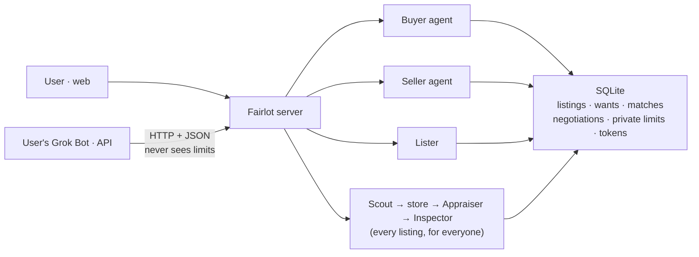

# Architecture

**Fairlot** is an AI-run classifieds board for SF Bay Area bikes, computers, and furniture. A person states a want. A buyer agent finds matching listings and negotiates inside a private max. Scout, Appraiser, and Inspector prepare every listing once, for everyone.

## Where the bots run

Two places. Pitch this split first: privacy depends on it.

**Site-run agents on our server.** Our backend calls the Grok API. These agents work for everyone, all the time:

| Agent | Job |
| --- | --- |
| Scout | Reads a few public pages and stores listings |
| Appraiser | Prices every listing against comps |
| Inspector | Scam-checks every listing |
| Lister | Drafts a listing from a seller's photo |
| Buyer | Hunts matches and negotiates inside the user's private max |
| Seller | Negotiates inside the seller's private minimum |

Negotiation has to run here. This process is the only one that can see a max or a minimum, and it never sends those numbers to the other agent, the browser, or a user's Grok Bot.

**The user's own Grok Bot is a client.** It talks to the site through a small public bot-facing API (plain HTTP + JSON): post a want, see matches, point the buyer agent at a listing, read offers and outcomes. The Grok Bot is the remote control. It never sees anyone's limits. Each want gets a private access token so only its creator can read its status or direct its agent.



One public service. FastAPI serves the built React app and the API on the same origin. No login for the public feed. Want routes require that want's access token.

LLM calls use the Grok API. The key is read from `GROK_API_KEY` and nowhere else. No key in source, docs, logs, or the frontend bundle. Optional `GROK_API_BASE_URL` overrides the API host.

Until real calls are wired, each agent is a stub over seed data. The Grok call is a single named seam per agent (`complete(...)` or equivalent).

Scout does not call the LLM. It only reads a few public pages, caches them, and writes listings. Then the server appraises and inspects each new row. That pipeline is global: one appraisal and one inspection per listing, shared by every user and every want.

## Data model

SQLite. Money is integer US dollars. JSON is `snake_case`. Timestamps are ISO-8601 UTC.

### Listing

| Field | Notes |
| --- | --- |
| `id` | `lst_` + short id |
| `category` | `bikes` \| `computers` \| `furniture` |
| `title` | |
| `description` | |
| `price` | Asking price, integer USD |
| `photos` | Image URLs. Seed rows use placeholders |
| `neighborhood` | Public area only, e.g. `Mission, San Francisco` |
| `source_url` | Public page, or null for a photo listing we published |
| `posted_at` | |
| `origin` | `seed` \| `scout` \| `lister` |

### Appraisal

| Field | Notes |
| --- | --- |
| `listing_id` | |
| `estimated_value` | Integer USD |
| `low` / `high` | Comparable range |
| `comps` | `{ title, price, url }[]` |
| `verdict` | `good_deal` \| `fair` \| `overpriced` |

Asking price under `low` → `good_deal`; inside `[low, high]` → `fair`; over `high` → `overpriced`.

### Inspection

| Field | Notes |
| --- | --- |
| `listing_id` | |
| `trust_level` | `high` \| `medium` \| `low` |
| `signals` | `{ code, reason }[]`. `reason` is one plain sentence. Empty list is fine |

### Want

| Field | Notes |
| --- | --- |
| `id` | `wnt_` + short id |
| `text` | Raw request |
| `criteria` | Output of `parse_want` (category, area, max is not here) |
| `status` | `open` \| `hunting` \| `negotiating` \| `done` |
| `created_at` | |

### WantAccess (server only)

| Field | Notes |
| --- | --- |
| `want_id` | |
| `access_token` | Returned once on create. Required on later want routes. Never logged |

### Match

| Field | Notes |
| --- | --- |
| `want_id` | |
| `listing_id` | |
| `score` | 0–1 |
| `reason` | One sentence |

### Negotiation

Visible state only.

| Field | Notes |
| --- | --- |
| `id` | `neg_` + short id |
| `listing_id` | |
| `want_id` | Null when started from `POST /api/negotiations` without a want |
| `status` | `closed` when the run finishes in the request |
| `outcome` | `deal` \| `no_deal` |
| `messages` | `{ from, kind, amount, text, at }[]`. `from` is `buyer` \| `seller`. `kind` is `offer` \| `counter` \| `accept` \| `decline`. `amount` is integer USD or null |

### PriceLimits (server only)

| Field | Notes |
| --- | --- |
| `listing_id` | Seller side. Primary key with optional `want_id` null |
| `want_id` | Set for a buyer's private max. Null for the listing's seller minimum |
| `buyer_max` | Highest the buyer agent may offer for this want. Null on a seller-only row |
| `seller_min` | Lowest the seller agent may accept. Null on a want-only row |

Never serialized. Not on any response model, not logged, not sent to the browser or to a Grok Bot. A deal is possible only when `buyer_max >= seller_min`. The transcript may show offers between those bounds. It must not show the bounds.

## Agent interfaces

```text
parse_want(text) -> WantCriteria
match_listings(criteria) -> list[Match]
negotiate(listing, buyer_max, seller_min) -> Negotiation   # limits stay in the server process
```

`WantCriteria` is public: category, area, keywords, and any non-secret constraints parsed from the text. The numeric max is stored only in `PriceLimits`, even if the user typed it in the same sentence.

Lister, Appraiser, and Inspector keep their existing functions: `draft_from_photo`, `appraise`, `inspect`.

## API contract

Base path `/api`. Errors: `{ "error": { "code": "not_found" | "bad_request" | "unauthorized" | "scout_stopped", "message": "..." } }`.

List and detail responses include appraisal and inspection so the feed can render badges without a second round trip. They never include `buyer_max`, `seller_min`, `price_limits`, or `access_token`.

Want routes (except create) require `Authorization: Bearer <access_token>` for that want. A wrong or missing token is `401`. The token is not a global account.

### `GET /api/listings?category=&q=`

`category` optional: `bikes` | `computers` | `furniture`. `q` optional match on title and description.

```json
{
  "listings": [
    {
      "id": "lst_demo",
      "category": "bikes",
      "title": "City bike, ready to ride",
      "price": 280,
      "photos": ["https://example.com/bike.jpg"],
      "neighborhood": "Temescal, Oakland",
      "posted_at": "2026-11-19T18:00:00Z",
      "origin": "seed",
      "appraisal": { "estimated_value": 340, "verdict": "good_deal" },
      "inspection": { "trust_level": "high" }
    }
  ]
}
```

### `GET /api/listings/{id}`

List fields plus `description`, `source_url`, full appraisal (`low`, `high`, `comps`), and full inspection (`signals`). `404` if missing.

### `POST /api/lister`

`multipart/form-data`, image field `photo`. Returns a draft. Does not publish.

```json
{
  "draft": {
    "category": "furniture",
    "title": "Oak desk",
    "description": "Small writing desk, visible wear on one edge.",
    "suggested_price": 90
  }
}
```

### `POST /api/listings`

Publishes a draft. Server sets `origin` to `lister`, runs Appraiser and Inspector, stores a server-side `seller_min`, and returns the listing detail shape. The client does not send limits.

### `POST /api/negotiations`

Runs a negotiation to a terminal outcome in this request. Body: `{ "listing_id": "lst_demo" }`. Loads limits on the server. Response is the visible transcript only. Ignore `buyer_max` or `seller_min` if a client sends them. Do not log them.

### `GET /api/negotiations/{id}`

Visible transcript: `id`, `listing_id`, `status`, `outcome`, `messages`. No limits.

### `POST /api/scout/run`

Body: `{ "categories": ["bikes", "computers", "furniture"] }`. Hard cap on pages. Response: `added`, `cached`, `stopped`, `report`. On CAPTCHA or block, stop immediately (`stopped: true`, `reason`: `captcha` | `blocked` | `other`). No retry around it. Each added listing is stored, then appraised, then inspected.

### `POST /api/wants`

Bot-facing and site-facing. Body:

```json
{
  "text": "road bike under $400 in SF",
  "category": "bikes",
  "area": "San Francisco"
}
```

`category` and `area` are optional. If `text` states a budget, the server stores that number as `buyer_max` and strips it from `criteria`. Response (token shown once):

```json
{
  "id": "wnt_demo",
  "access_token": "tok_example_not_a_real_secret",
  "status": "open"
}
```

### `GET /api/wants/{id}`

Bearer token required. Returns criteria, status, matches (with that listing's appraisal and trust), and negotiations. Never the max, the seller minimum, or the token.

```json
{
  "id": "wnt_demo",
  "text": "road bike under $400 in SF",
  "criteria": {
    "category": "bikes",
    "area": "San Francisco",
    "keywords": ["road bike"]
  },
  "status": "negotiating",
  "matches": [
    {
      "listing_id": "lst_demo",
      "score": 0.86,
      "reason": "Road bike in San Francisco, asking price inside the stated budget.",
      "appraisal": { "estimated_value": 340, "verdict": "good_deal" },
      "inspection": { "trust_level": "high" }
    }
  ],
  "negotiations": [
    {
      "id": "neg_demo",
      "listing_id": "lst_demo",
      "status": "closed",
      "outcome": "deal"
    }
  ]
}
```

### `POST /api/wants/{id}/hunt`

Bearer token required. Buyer agent searches and opens negotiations with the top matches. Returns the same shape as GET, with `status` moving to `hunting` or `negotiating`.

### `POST /api/wants/{id}/target`

Bearer token required. Directs the buyer agent at one listing.

```json
{ "listing_id": "lst_demo" }
```

Opens one negotiation for that pair and returns the want shape.

## Key design decisions

**Private limits stay on the server.** Response models omit them. Logs must not print them. The frontend and any Grok Bot must not receive or hardcode them. Tests fail if `buyer_max`, `seller_min`, `price_limits`, or `access_token` show up on read responses or in OpenAPI response schemas for those reads. The create response is the one place `access_token` appears.

**Global vetting.** Appraiser and Inspector are not per user. Scout → store → appraise → inspect runs for every listing. Wants only read those results.

**Scout rules.** Public pages only. A few pages per run. No sign-in, posting, messaging, or accounts. Cache and reuse. On CAPTCHA or block, stop and report. Do not solve or evade it.

**One deployable service.** `vite build` output is served by FastAPI next to `/api`. Judges get one public link.

**Seed data is obvious.** `origin: "seed"` rows are stand-ins. The UI may mark them Sample.

**AI is the product.** The feed shows verdict and trust. A want becomes a hunt. Sell starts from a photo. Negotiation is two agents. There is no general chat box.

## User flows

**Want.** Type the want on the site, or send it from a Grok Bot → `POST /api/wants` → keep the token → `POST /api/wants/{id}/hunt` → read matches, appraisals, trust, and outcomes. Or `POST /api/wants/{id}/target` for one listing. The screen never shows the max.

**Browse.** Feed → category chips → photo, price, verdict, trust → listing detail.

**Sell with a photo.** Photo → Lister draft → publish → listing is already appraised and inspected. Seller agent uses the server-side minimum.

**Make an offer.** From a listing, `POST /api/negotiations`, or from a want via hunt/target. Transcript shows offers and deal / no deal only.
