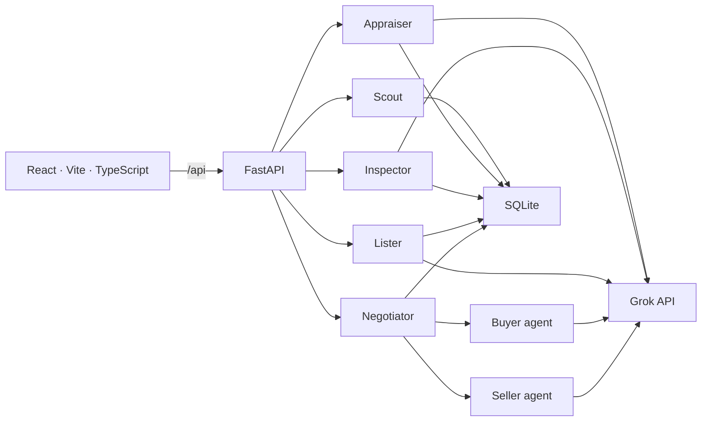

# Architecture

Working name: **Fairlot**. A photo-first classifieds board for SF Bay Area bikes, computers, and furniture. AI agents prepare every listing (find it, price it, check it, write it) and negotiate inside limits that never leave the server.

The API contract below is frozen at T+0:15. Change it only if all three people agree.

## System overview

One public service. FastAPI serves the built React app and the API on the same origin, so judges open a single link on a laptop or a phone. No login.



Scout does not call the LLM. It only reads a few public pages, caches them, and writes listings.

LLM calls use the Grok API. The key is read from the `GROK_API_KEY` environment variable and nowhere else. No key in source, docs, logs, or the frontend bundle. Optional `GROK_API_BASE_URL` overrides the API host; the default stays in server config, not in the client.

Until real calls are wired, each agent is a working stub over seed data. The function that would call Grok is a single, named seam per agent (`complete(...)` or equivalent) so swapping the stub for a real call does not change the HTTP contract.

## Data model

SQLite. Money is integer US dollars (no floats). JSON fields are `snake_case`. Timestamps are ISO-8601 UTC.

### Listing

| Field | Notes |
| --- | --- |
| `id` | `lst_` + short id |
| `category` | `bikes` \| `computers` \| `furniture` |
| `title` | |
| `description` | |
| `price` | Asking price, integer USD |
| `photos` | List of image URLs. Seed rows use placeholder images |
| `neighborhood` | Public area only, e.g. `Mission, San Francisco`. No street address |
| `source_url` | Public page the listing came from, or null for a photo listing we published |
| `posted_at` | |
| `origin` | `seed` \| `scout` \| `lister`. Seed rows stay labeled `seed` until replaced |

### Appraisal

| Field | Notes |
| --- | --- |
| `listing_id` | |
| `estimated_value` | Integer USD |
| `low` / `high` | Comparable range |
| `comps` | `{ title, price, url }[]`. `url` is a public page |
| `verdict` | `good_deal` \| `fair` \| `overpriced` |

Verdict guide (stub and model should match): asking price under `low` → `good_deal`; inside `[low, high]` → `fair`; over `high` → `overpriced`.

### Inspection

| Field | Notes |
| --- | --- |
| `listing_id` | |
| `trust_level` | `high` \| `medium` \| `low` |
| `signals` | `{ code, reason }[]`. `reason` is one plain sentence a buyer can read. Empty list is fine |

### Negotiation

Visible state only.

| Field | Notes |
| --- | --- |
| `id` | `neg_` + short id |
| `listing_id` | |
| `status` | `closed` for this build (the POST runs to a terminal outcome) |
| `outcome` | `deal` \| `no_deal` |
| `messages` | `{ from, kind, amount, text, at }[]`. `from` is `buyer` \| `seller`. `kind` is `offer` \| `counter` \| `accept` \| `decline`. `amount` is integer USD or null |

### PriceLimits (server only)

| Field | Notes |
| --- | --- |
| `listing_id` | Primary key |
| `buyer_max` | Highest the buyer agent may offer |
| `seller_min` | Lowest the seller agent may accept |

This table is never serialized. It is not a field on any Pydantic response model, not logged, and not sent to the frontend. Seed limits live in server code or in this table only.

A deal is possible only when `buyer_max >= seller_min`. The transcript may show offers between those bounds. It must not show the bounds themselves.

## API contract

Base path `/api`. Errors: `{ "error": { "code": "not_found" | "bad_request" | "scout_stopped", "message": "..." } }` with the matching HTTP status.

List and detail responses include appraisal and inspection summaries so the feed can render badges without a second round trip. They never include `buyer_max`, `seller_min`, or a `price_limits` object.

### `GET /api/listings?category=&q=`

`category` optional: `bikes` \| `computers` \| `furniture`. Omit for all three. `q` optional case-insensitive match on title and description.

```json
{
  "listings": [
    {
      "id": "lst_demo",
      "category": "bikes",
      "title": "City bike, ready to ride",
      "price": 280,
      "photos": ["https://example.com/bike.jpg"],
      "neighborhood": "Temescal, Oakland",
      "posted_at": "2026-11-19T18:00:00Z",
      "origin": "seed",
      "appraisal": { "estimated_value": 340, "verdict": "good_deal" },
      "inspection": { "trust_level": "high" }
    }
  ]
}
```

### `GET /api/listings/{id}`

Same listing fields as the list item, plus `description` and `source_url`, full `appraisal` (`low`, `high`, `comps`), and full `inspection` (`signals`). `404` if missing.

```json
{
  "id": "lst_demo",
  "category": "bikes",
  "title": "City bike, ready to ride",
  "description": "Commuter frame, recent tune-up.",
  "price": 280,
  "photos": ["https://example.com/bike.jpg"],
  "neighborhood": "Temescal, Oakland",
  "source_url": null,
  "posted_at": "2026-11-19T18:00:00Z",
  "origin": "seed",
  "appraisal": {
    "estimated_value": 340,
    "low": 300,
    "high": 420,
    "comps": [
      { "title": "Similar city bike", "price": 350, "url": "https://example.com/comp" }
    ],
    "verdict": "good_deal"
  },
  "inspection": {
    "trust_level": "high",
    "signals": []
  }
}
```

### `POST /api/lister`

`multipart/form-data` with one image field, `photo`. The Lister proposes category, title, description, and a suggested asking price. This does not publish.

```json
{
  "draft": {
    "category": "furniture",
    "title": "Oak desk",
    "description": "Small writing desk, visible wear on one edge.",
    "suggested_price": 90
  }
}
```

### `POST /api/listings`

Publishes a draft. Body:

```json
{
  "category": "furniture",
  "title": "Oak desk",
  "description": "Small writing desk, visible wear on one edge.",
  "price": 90,
  "photos": ["https://example.com/desk.jpg"],
  "neighborhood": "Mission, San Francisco"
}
```

Server sets `origin` to `lister`, runs Appraiser and Inspector, and returns the `GET /api/listings/{id}` shape. The client does not send price limits. The server creates a `PriceLimits` row on its own (seed policy or a server-side rule) and does not return it.

### `POST /api/negotiations`

Starts a negotiation and runs it to a terminal outcome in this same request (no websocket for the 2-hour build).

```json
{ "listing_id": "lst_demo" }
```

The handler loads `PriceLimits` for that listing on the server. Response is the visible transcript only — same shape as GET. `404` if the listing or its limits row is missing. Do not accept `buyer_max` or `seller_min` in this body; if a client sends them, ignore them and do not log them.

### `GET /api/negotiations/{id}`

```json
{
  "id": "neg_demo",
  "listing_id": "lst_demo",
  "status": "closed",
  "outcome": "deal",
  "messages": [
    {
      "from": "buyer",
      "kind": "offer",
      "amount": 300,
      "text": "I can do 300 if I pick it up this week.",
      "at": "2026-11-19T18:05:00Z"
    },
    {
      "from": "seller",
      "kind": "accept",
      "amount": 300,
      "text": "That works. Pickup this week.",
      "at": "2026-11-19T18:05:02Z"
    }
  ]
}
```

### `POST /api/scout/run`

```json
{ "categories": ["bikes", "computers", "furniture"] }
```

The server clamps work to a few public pages per run (hard cap, not a client-controlled crawl). Response:

```json
{
  "added": 0,
  "cached": 0,
  "stopped": false,
  "report": null
}
```

If a CAPTCHA or block appears, stop immediately. Do not retry around it.

```json
{
  "added": 0,
  "cached": 0,
  "stopped": true,
  "report": {
    "reason": "captcha",
    "message": "Scout stopped. The page returned a challenge. No workaround was attempted."
  }
}
```

`reason` is `captcha` \| `blocked` \| `other`.

## Key design decisions

**Price limits stay on the server.** Response models do not include them. Logs must not print the limits row or those two numbers. The frontend never receives them and must not hardcode them. `backend` tests load the OpenAPI schema and the negotiation payloads and fail if `buyer_max`, `seller_min`, or `price_limits` appear.

**Scout rules.** Public pages only. A few pages per run, then stop. No sign-in, posting, messaging, or account creation. Cache results and reuse the cache instead of refetching. On any CAPTCHA or block, stop and return `stopped: true` with a report. Do not solve, evade, or rotate around the challenge. The scaffold does not request Craigslist; the module is structured so a polite fetcher can be plugged in later.

**One deployable service.** `vite build` writes static files; FastAPI serves that directory and `/api`. Same-origin calls, so the production UI needs no API base URL and no CORS. Local Vite dev may set `VITE_API_BASE_URL` and the API may allow that dev origin via `CORS_ORIGINS`. Judges get one public link, no install, no account.

**Seed data is obvious.** Rows with `origin: "seed"` are stand-ins (about a dozen across the three categories, placeholder images). Replacing them is a Scout write of the same `Listing` shape plus Appraiser and Inspector runs. The UI may show a small "Sample" mark on seed rows so a live demo is not confused with real posts.

**AI is the product, not a side panel.** The feed shows the verdict and trust badges. Sell starts from a photo. Negotiation is the buyer and seller agents talking. There is no general chat box.

## User flows

**Browse.** Open the feed → filter with Bikes / Computers / Furniture (and optional search) → scan photo, price, verdict badge, trust badge → open a listing → read the range, comps, and any scam-signal reasons. Next step on the page is "Make an offer".

**Sell with a photo.** Choose a photo → `POST /api/lister` → edit the draft if needed → `POST /api/listings` → land on the new listing, already appraised and inspected.

**Make an offer.** From a listing, start negotiation → `POST /api/negotiations` → show the transcript → outcome is deal or no deal. The screen never shows the hidden floor or ceiling.
