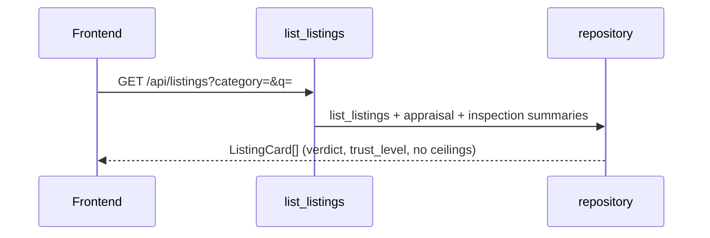
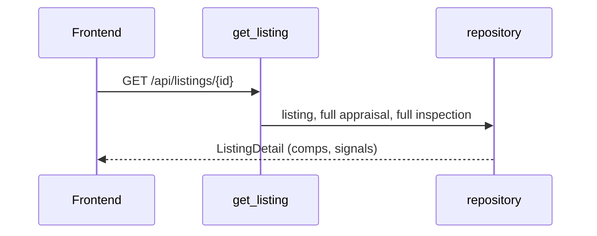
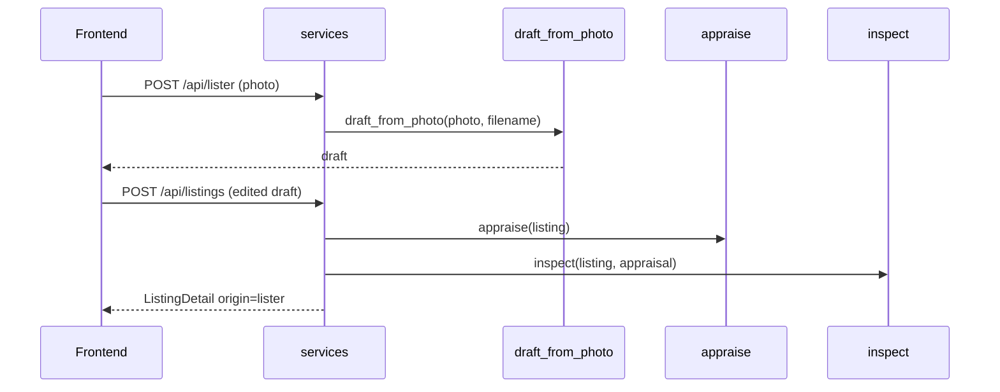
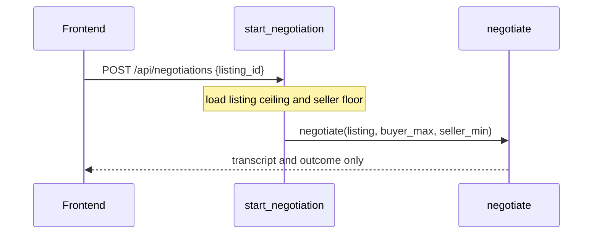
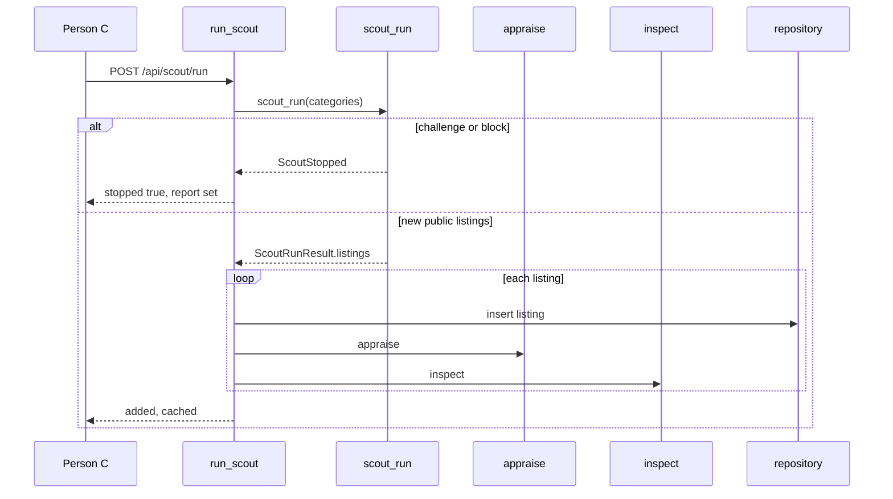
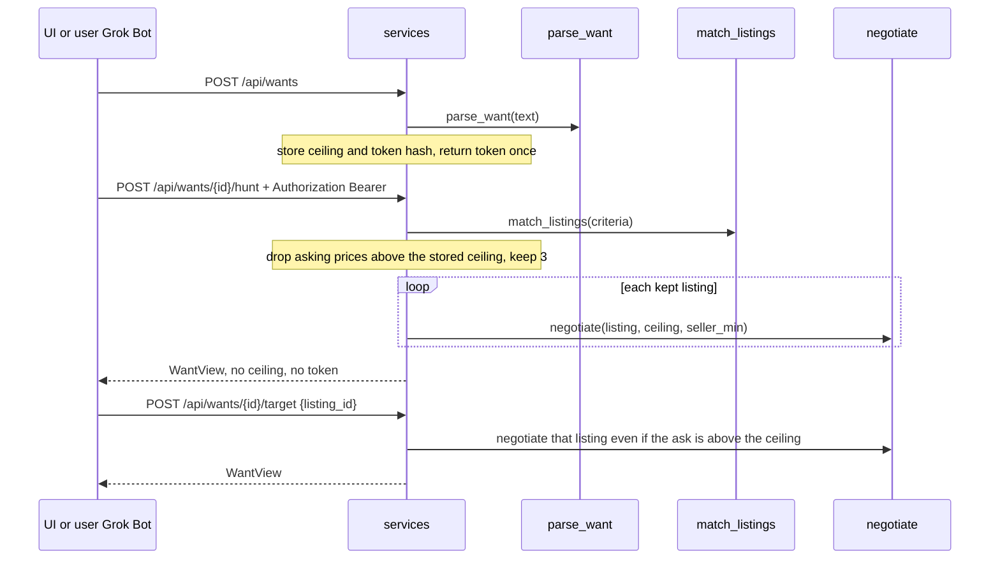

# Integration

How the pieces call each other. Product behavior is in `docs/ARCHITECTURE.md`. A user's bot follows `docs/GROKBOT_INTEGRATION.md`. If this file and the code disagree, the code in `backend/app/schemas.py` and the routes win, and this file gets fixed in the same change.

JSON is `snake_case`. Money is integer US dollars. Enums exist only in `backend/app/schemas.py`:

| Name | Values |
| --- | --- |
| category / origin | `bikes` `computers` `furniture` / `seed` `scout` `lister` |
| verdict | `good_deal` `fair` `overpriced` |
| trust_level | `high` `medium` `low` |
| negotiation | status `closed`; outcome `deal` `no_deal`; message `from` `buyer` `seller`; `kind` `offer` `counter` `accept` `decline` |
| want status | `open` `hunting` `done` |
| scout reason | `captcha` `blocked` `other` |
| error code | `not_found` `bad_request` `scout_stopped` |

Errors are `{ "error": { "code", "message" } }`. Validation failures use `bad_request` and do not echo the body.

## Who calls whom

```text
HTTP route (routes.py)
  -> service function (services.py)
    -> agent function (backend/app/agents/)
    -> repository (repository.py) -> SQLite
```

The service is the only layer that reads a private ceiling or a token hash. Agent return values do not include those.

## Sequence diagrams

### Browse feed



### Open listing



### Sell with a photo



The server stores a ceiling for the new listing. The response does not include it.

### Make an offer (on-site)



### Scout run



The stub returns no listings and does not open a network connection.

### Post a want, hunt, or target one listing



`GET /api/wants/{id}` is the same view, with the same header, and does not start new talks.

## Boundary table

### Routes -> services

| HTTP | Service |
| --- | --- |
| `GET /api/listings` | `list_listings(category: str \| None, q: str \| None) -> ListingListResponse` |
| `GET /api/listings/{id}` | `get_listing(listing_id: str) -> ListingDetail` |
| `POST /api/lister` | `create_draft(photo: bytes, filename: str \| None) -> ListerResponse` |
| `POST /api/listings` | `publish_listing(body: PublishListingRequest) -> ListingDetail` |
| `POST /api/negotiations` | `start_negotiation(listing_id: str) -> Negotiation` |
| `GET /api/negotiations/{id}` | `get_negotiation(negotiation_id: str) -> Negotiation` |
| `POST /api/scout/run` | `run_scout(categories: list[str]) -> ScoutRunResponse` |
| `POST /api/wants` | `create_want(text, category, area, max_price) -> WantCreated` |
| `GET /api/wants/{id}` | `get_want(want_id, token) -> WantView` |
| `POST /api/wants/{id}/hunt` | `hunt_want(want_id, token) -> WantView` |
| `POST /api/wants/{id}/target` | `target_want(want_id, token, listing_id) -> WantView` |

Hunt and target go through `runner.run_hunt(want_id)` and `runner.run_target(want_id, listing_id)`, which call `execute_hunt` / `execute_target`. The runner is synchronous.

### Services -> agents

| Caller | Function | Returns |
| --- | --- | --- |
| publish, scout | `appraise(listing: ListingRecord) -> Appraisal` | range, comps, verdict |
| publish, scout | `inspect(listing: ListingRecord, appraisal: Appraisal) -> Inspection` | trust_level, signals |
| create_draft | `draft_from_photo(photo: bytes, filename: str \| None = None) -> Draft` | category, title, description, suggested_price |
| create_want | `parse_want(text: str) -> WantCriteria` | category, area, keywords. No ceiling |
| create_want | `private_max_from_text(text: str) -> int \| None` | used only when the request omitted `max_price`. Not returned |
| execute_hunt | `match_listings(criteria: WantCriteria) -> list[Match]` | `Match(listing_id, score)` best first |
| negotiations | `negotiate(listing: ListingRecord, buyer_max: int, seller_min: int) -> NegotiationDraft` | outcome + messages. No bounds |
| scout route | `scout_run(categories: list[str]) -> ScoutRunResult` | listings to store, or `ScoutStopped` |

`WantCriteria` and `Match` live in `backend/app/agents/buyer.py`. `NegotiationDraft` lives in `negotiator.py`. `ListingRecord` and `Limits` live in `repository.py`. HTTP models live in `schemas.py`.

`complete(prompt: str, *, image: bytes | None = None, timeout_s: float = 8.0) -> str | None` is the only Grok call. `None` means "use the stub". Prompts must not include a ceiling, a floor, or a token.

### Services -> repository

Public reads must not select `price_limits`, `wants.max_price`, or `wants.token_hash`.

| Function | Use |
| --- | --- |
| `list_listings` / `get_listing` / `get_appraisal` / `get_inspection` | feed and detail |
| `insert_listing(listing, appraisal, inspection, limits)` | seed, publish, scout |
| `get_limits(listing_id) -> Limits \| None` | seller floor and the on-site buyer ceiling |
| `insert_negotiation` / `get_negotiation` | transcripts |
| `insert_want(...)` | includes ceiling and token hash. Not a response |
| `get_want` | public columns only |
| `get_token_hash` / `get_want_max` | auth and hunt. Separate queries |
| `upsert_want_match` / `list_want_matches` | score and negotiation id |

## Rules that keep this stable

- Field names and enums above stay put. Add a response field only with all three people.
- Price ceilings and seller floors never cross the API. They are not response fields, log lines, or OpenAPI examples. `POST /api/wants` may return `access_token` once. No other response includes it.
- Later want routes send `Authorization: Bearer <access_token>`. A missing or wrong token is `401` with code `unauthorized`.
- A wrong token and an unknown want both return 404 `Want not found.`
- Agent failures and a missing `GROK_API_KEY` fall back to the `stub_*` result. The HTTP shape does not change.
- Hunt keeps at most `MAX_HUNT_MATCHES` (3) after dropping asks above the stored ceiling. Target always negotiates the chosen listing.
- Env: `GROK_API_KEY`, `GROK_API_BASE_URL`, `CORS_ORIGINS` (default `http://localhost:5173`), `DATABASE_PATH`. The frontend uses `VITE_API_BASE_URL` (empty means same origin). Person A owns that client. Types should follow `GET /openapi.json`.

## Where to plug in your part

### @unclesdad — frontend

Do not edit `backend/`. Build the client against the routes above. Badge values are the verdict and trust enums. The want screens, when you get there, send `Authorization: Bearer` and never render a ceiling. There is no frontend in the plumbing branch on purpose.

### @srivatsav-kannan — agents

Replace the body, keep the signature.

| File | Function |
| --- | --- |
| `backend/app/agents/buyer.py` | `parse_want`, `match_listings`, `private_max_from_text` |
| `backend/app/agents/negotiator.py` | `negotiate` |
| `backend/app/agents/appraiser.py` | `appraise` |
| `backend/app/agents/inspector.py` | `inspect` |
| `backend/app/agents/lister.py` | `draft_from_photo` |
| `backend/app/agents/llm.py` | `complete` |

Leave the `stub_*` functions in place and call them when `complete()` returns `None`. Do not edit `scout.py`, `services.py`, or `schemas.py`.

### @heruirayli — data, API, ship

You own the route, service, repository, schema, runner, seed, and Scout files. `scout_run` is the fetch plug-in. On a challenge, raise `ScoutStopped(reason, message)` and stop. `runner.py` is the plug-in for a later queue. Keep `docs/GROKBOT_INTEGRATION.md` equal to the live JSON.
